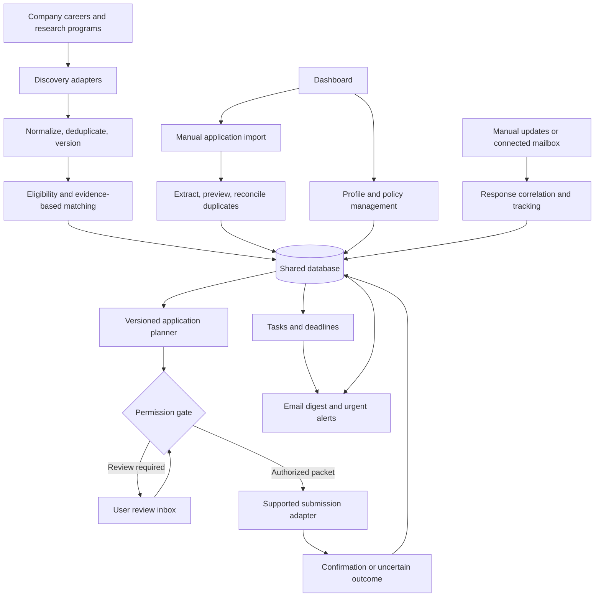
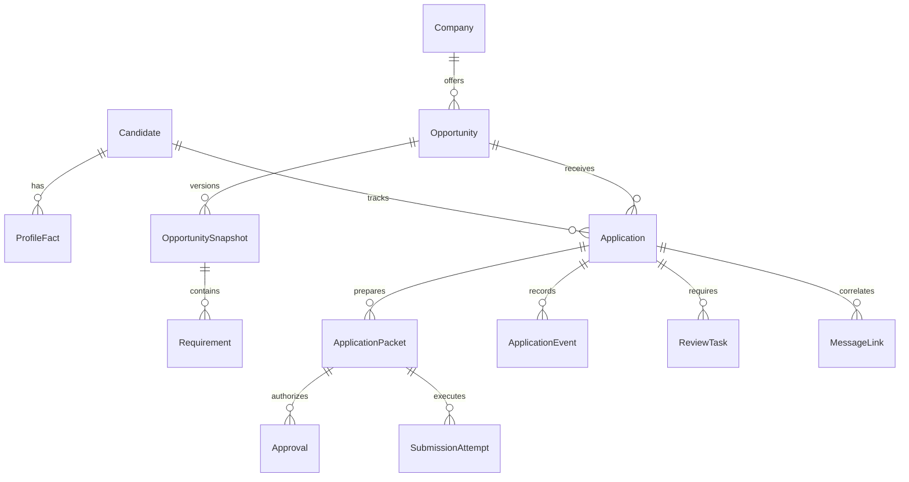

# Lelouvre architecture

Design revision 1 - October 19, 2026. Companion to SYSTEM_DESIGN.md. This is the target architecture. Implemented subsets are the local Python/SQLite tracker and an initial read-only scouting loop with public sources, explicit matching rules, snapshots, health/run logs, and local scheduling; see README.md for exact coverage. Broad discovery, model-assisted extraction, email connections, packet planning, and submission execution remain future components.

Current correction: roles are discovered by SWE, cybersecurity/cloud-security, or undergraduate-research category plus season and location. Resume skill overlap is application evidence only and cannot gate discovery. A controlled application pipeline now persists packets, policy decisions, execution status, receipts, and reconciled application records; live employer hosts are still disabled pending adapter validation.

Screen flows, actions, and failure states are specified in SCREEN_SPEC.md.

The scholarship extension in SCHOLARSHIPS.md adds shared opportunity types and sponsor organizations, with separate eligibility, stages, award records, and review rules. It supersedes internship-only entity names when implementing shared storage.

## Component boundaries

Discovery target coverage includes employer careers, LinkedIn, web search, Reddit, X, research programs, and public internship lists. Each channel needs its own supported access strategy, scheduling/rate-limit rules, attribution, and health state. APIs, permitted public retrieval, or user-connected sessions are evaluated per source during implementation. Restricted access produces a visible coverage gap; no login, CAPTCHA, or access-control bypass is part of the design. Discovery adapters cannot upload candidate data.

Separate lead discovery from authoritative opportunity verification. A Reddit/X post or search result can create a lead but cannot by itself authorize submission. Resolve employer identity, actual destination, season, current availability, and requirements. Some research programs may use official program pages rather than an employer ATS.

Routine Easy Apply is a submission adapter capability, not a blanket authorization category. With an approved profile and supported connected site, the agent may autonomously prepare and submit a routine packet under policy. Platform-specific access/support is determined before enabling that adapter. Unconfirmed authorization currently blocks any application requiring those answers. Verified success commits the application event and receipt before notification; uncertain outcomes enter reconciliation and never count as confirmed applied.



Use one modular application and one database initially. A persistent scheduler/queue runs discovery, extraction, notification, and reconciliation jobs. Browser execution is a separate capability behind the permission gate, not a tool available directly to the language model. The dashboard reads through application services rather than writing arbitrary database records.

## Logical database schema

All entities use stable IDs. Store timestamps in UTC and display them in the user's timezone. Keep date-only values as dates; an unknown application date must not become the import date. Use foreign keys, explicit nullability, constrained state values, and transactional writes. JSON is suitable for versioned field payloads; identity, relationships, dates, and status belong in typed columns.

| Entity | Important fields and relationships |
|---|---|
| Candidate | ID, display name, timezone, profile revision |
| ProfileFact | Candidate, fact key, typed value, evidence reference, verification status, revision |
| PreferencePolicy | Candidate, revision, target season, locations, track priorities, pause flags, company caps |
| AnswerRule | Candidate, revision, question meaning, approved answer, permitted context, approval date, revocation date |
| DocumentVersion | Candidate, document type, private storage reference, content hash, approval state, previous version |
| Company | Name, verified domains, always-review flag, application limits |
| Source | Company when known, source type, URL, adapter, cadence, enabled state |
| SourceCheck | Source, start/end times, outcome, error category, last successful fetch metadata |
| Opportunity | Company, canonical URL, requisition ID when known, season, title, availability, first seen, last verified |
| OpportunitySource | Opportunity, source, source-specific identifier and URL; supports multiple discovery paths |
| OpportunitySnapshot | Opportunity, immutable description hash, private content reference, source publication/deadline values, fetched time |
| Requirement | Snapshot, category, required/preferred, extracted value, supporting excerpt, extraction confidence |
| MatchEvaluation | Candidate, snapshot, profile/policy revisions, eligibility result, reasons, component scores, evidence links, model/rules version |
| ManualImport | Candidate, input type, private evidence reference, extraction result, uncertainties, review state, linked application |
| Application | Candidate, opportunity, cycle key, origin, progress, submission evidence level, reported application date, current revision |
| ApplicationPacket | Application, immutable packet hash, snapshot, document versions, exact fields, question fingerprint, profile/policy revisions |
| ReviewTask | Application when relevant, task type, blocking flag, due date, status, resolution and actor |
| Approval | Exact packet, authorization type, policy revision or user decision, expiry/revocation and actor |
| SubmissionAttempt | Application, packet, idempotency key, adapter version, execution state, start/end times, confirmation evidence, error |
| ApplicationEvent | Application, event type, prior/new state, occurrence time, recorded time, actor, evidence, correction reference |
| MessageLink | Application, provider/message identifier, category, confidence, evidence reference; ambiguous matches stay unlinked |
| WorkItem | Job type, deduplication key, status, lease owner/expiry, retry count, next run, structured error |
| Notification | Candidate, event reference, channel, deduplication key, delivery status, attempt count, next attempt |

Files and screenshots live in private artifact storage; the database holds references and hashes. Credentials and browser secrets live separately in an OS credential store. Evidence deletion must remove or redact sensitive payloads as well as references under a defined retention policy.



## Identity and duplicate rules

- Prefer company plus requisition ID for opportunity identity; otherwise canonicalize a verified official URL. Similar title/location is a candidate duplicate, not sufficient grounds for automatic merging.
- Enforce one application per candidate, canonical opportunity, and cycle. A legitimate reapplication requires an explicit new cycle and user review.
- Manual records may create a provisional opportunity with company and role only. They block exact duplicate submissions when identity is resolved; unresolved possible duplicates block affected submissions for review.
- Imports, discoveries, work items, and notification events each have stable deduplication keys enforced by database uniqueness constraints.
- A merge preserves aliases, evidence, and original IDs in a merge event. Support reversing an incorrect merge; never silently overwrite conflicting progress or dates.

## Manual application workflow

```text
Enter company/role or provide a link, screenshot, or confirmation
    -> Save private import record
    -> Extract proposed fields and show uncertainty
    -> Search existing opportunities and applications
    -> Preview create, link, or merge action
    -> User confirms ambiguous identity, conflicts, or extracted changes
    -> Commit application and history event in one transaction
    -> Reconcile pending submission work and schedule relevant tasks
```

Direct structured entry may save immediately when identity is unambiguous. Uncertain extraction requires review. Minimum entry: company and role. Optional: URL, requisition ID, date, location, stage, resume, confirmation, notes. Preserve origin and evidence level separately: user_reported, receipt_confirmed, or employer_response_confirmed. Never claim a receipt exists based only on user entry.

Manual applications can enter at applied, assessment, interview, offer, rejected, or withdrawn. When an import races with an agent submission, acquire the same per-application submission lock and reconcile the attempt; never quietly create a second application.

## Independent state dimensions

| Dimension | Allowed values | Meaning |
|---|---|---|
| Posting availability | unknown, open, closed | Whether applications are currently accepted |
| Application progress | preparing, ready, applied, assessment, interview, offer, rejected, withdrawn | Candidate's progress with the employer |
| Execution | queued, running, waiting_user, failed, uncertain, completed, cancelled | State of one work item or submission attempt |
| Review task | open, resolved, dismissed | A separate decision or missing-information item |

Discovered/saved/archived are opportunity inbox dispositions, not application stages. No application record is necessary until preparation or manual logging begins. Failed retrieval records a source failure; it does not prove a posting closed. Silence does not imply rejection.

## Transition rules

| Trigger | Preconditions | Atomic result |
|---|---|---|
| Begin preparation | Identified opportunity | Create preparing application and event |
| Packet becomes ready | Required facts complete; eligibility resolved; current document/packet approved under policy | Set ready and record packet revision |
| Enqueue submission | Ready, no blockers, valid authorization, not paused, no previous confirmed/uncertain attempt | Create unique queued attempt |
| Start submission | Recheck authorization, current questions, availability, duplicates, and pause state under lock | Lease attempt and mark running |
| Verified confirmation | Receipt or explicit site confirmation tied to attempt | Mark applied, completed attempt, store evidence and event |
| Ambiguous result after submit boundary | Submission may have occurred | Mark attempt uncertain, leave progress unchanged, create blocking reconciliation task |
| Failure before submit boundary | Known that no submission occurred | Mark failed; bounded retry allowed after revalidation |
| Substantive packet or question changes | Any unexecuted packet | Supersede packet, invalidate authorization for old packet, cancel queued attempt, return ready application to preparing |
| Employer response | Reliably correlated message or user update | Update progress and create event/tasks; no required intermediate stage |
| Posting closes | Verified source evidence | Change availability only; cancel unstarted submission work |
| User correction | Explicit corrected fields and reason | Record compensating event and recompute current state |

Rejected and withdrawn stop automatic submission attempts. Offer is not accepted automatically. Corrected or reopened cases require explicit review before resuming. Assessments are tracked as tasks and are not completed automatically.

## Permission matrix

Candidate authorization and sponsorship answers must be supplied locally and reviewed for the exact employer question. Do not infer them from student status.

Approved answer update: Yes for the combined now-or-in-the-future sponsorship question, as supplied by the user. Current authorization and internship-only sponsorship questions remain unresolved. Match question meaning and context, not merely the presence of the word sponsorship; the unconfirmed-authorization blocker below concerns those remaining questions.

| Action | Automatic when | Review/block condition |
|---|---|---|
| Discover and rank | Source enabled; allowed access; rate limits respected | Untrusted source or unresolved identity |
| Fill routine facts | Approved fact and exact field meaning/context match | Unknown, conflicting, or changed meaning |
| Upload resume | Approved immutable document version for this packet | New or edited version |
| Answer work authorization | Exact approved answer exists for the context | Currently blocked: authorization unconfirmed |
| Draft substantive writing | Evidence supports all claims | User approval required before use |
| Submit | Valid packet authorization; supported adapter; all checks pass | Any blocker, pause, uncertain prior submission, or material change |
| Process responses | Connected access or user-provided update; reliable correlation | Ambiguous company/role/thread |
| Send alerts | Delivery connection and destination configured; event policy applies | Missing configuration or suppressed duplicate |
| Send recruiter communications | Separate explicit user authorization | Never implied by permission to submit applications |

The model proposes structured values and evidence. Deterministic code grants or denies actions. Approval cannot override missing required facts or silently change factual answers. A change after approval must be re-evaluated. External pages, emails, and documents cannot modify rules, authorize actions, or select upload destinations.

## Reliability, privacy, and operation

- Transactionally reserve submission work per application. Revalidate immediately before the irreversible submit action; avoid holding a database transaction open during network/browser work.
- Use leased work items with heartbeats. An expired browser job that crossed the submit boundary becomes uncertain, rather than automatically requeued.
- A local idempotency key prevents duplicate local jobs but does not guarantee an employer's server implements idempotency. Reconcile receipts before retries.
- Keep a notification outbox committed with the originating event. Use provider deduplication where available; ambiguous email delivery may otherwise produce duplicates and must remain visible.
- Use retry budgets and source-specific backoff for reads. Source health and alert-delivery failures need dashboard visibility.
- Restrict browser destinations to verified employer/application domains, with controlled handling of legitimate ATS redirects. Block arbitrary uploads and tool instructions in retrieved content.
- Redact personal data from operational logs. Define private document storage, session isolation, authenticated access, retention, backup encryption, and restore procedures before deployment.
- Pause-all-submissions is checked both at scheduling and immediately before submit. Discovery may continue while submission is paused.
- Monitoring while the computer is off requires an always-on host. Hosting choice and costs remain open; do not promise continuous operation until configured.

## Architecture acceptance scenarios

1. Ingesting the same listing from two sources produces one opportunity with two source links.
2. Importing an already-applied role creates or updates one application and prevents a duplicate submission.
3. A changed sponsorship question blocks execution and invalidates the old packet authorization.
4. A crash after clicking submit produces an uncertain attempt and no automatic resubmission.
5. A closed listing preserves interview progress and historical description snapshots.
6. An ambiguous response creates a review task without changing an unrelated application's progress.
7. Restarting a worker resumes safe queued work without duplicating confirmed applications.
8. A source outage shows stale coverage rather than reporting zero opportunities or mass closures.
9. An unsupported claim in generated text blocks packet readiness.
10. A user correction or duplicate merge retains enough history to inspect and reverse the change.
11. Simultaneous manual import and queued submission reconcile under one application identity.
12. Pausing submissions prevents a queued worker from submitting even if its packet was previously authorized.

## Decisions still needed before implementation of affected features

- Email destination, digest schedule, urgency thresholds, and delivery provider.
- Remote preference, exact summer dates, pay/housing preferences, and research topic priorities.
- Confirmed work authorization and exact screening answers before relevant submissions.
- Local versus hosted operation, hardware available for a local model, and budget.
- Retention periods and access model before storing connected email or browser sessions.

These decisions do not block discovery and manual-tracker implementation. Schema constraints, migrations, adapter contracts, and executable tests follow this logical design; they have not been implemented yet.
