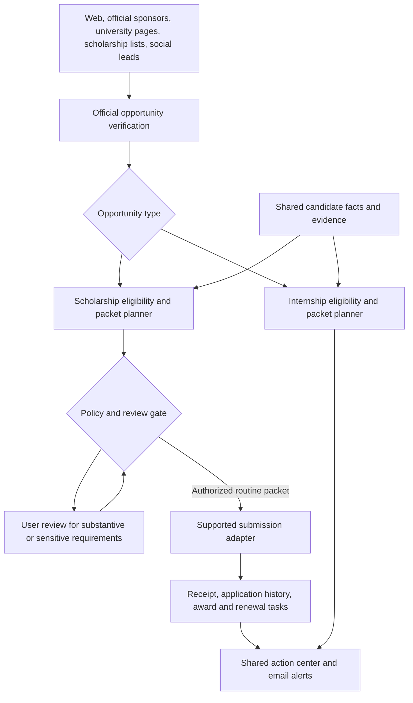

# Lelouvre scholarship track

Architecture extension, October 19, 2026. Manual scholarship logging, cycle-aware duplicate checks, stages, notes, tasks, history, and CSV export are implemented. The first scout also watches two configured official scholarship program pages; one returned useful content in the initial live check, while the other requires a dedicated adapter. These records are program-page leads, not individually verified open scholarships. Submissions and delivery are inactive. Remaining sections describe the target functionality.

## Scope

Find scholarships broadly, verify official sponsor/program information, assess eligibility with evidence, prepare applications, track manually and automatically submitted applications, and notify the candidate about openings, decisions, and deadlines.

Unlike internships, do not restrict scholarships to Summer 2027 or outside South Carolina. Use applicable academic year, enrollment, permitted institutions/locations, award terms, and candidate eligibility. Exact preferred award cycles remain configurable. Initial relevant categories: undergraduate CS, cybersecurity, technology, HBCU student opportunities, leadership, and research. These categories guide discovery; they do not establish eligibility.

Existing resume honors may identify prior award relationships but do not prove renewability, new-cycle eligibility, citizenship, financial need, or demographic eligibility. Previously received awards and submitted applications can be manually logged.

## Shared architecture

Share source adapters where compatible, verification infrastructure, candidate facts, private documents, task/review inbox, audit history, outboxes, notifications, and manual import. Keep type-specific eligibility, fields, statuses, and packet planning in separate modules. Employer sponsorship answers never become scholarship citizenship/residency answers.

## Scholarship data

Generalize Company to Organization (employer, scholarship sponsor, university, research program; multiple roles permitted) and Opportunity to a shared record with a required opportunity type. Existing company references become employer organization references through migration when implementation begins. Add a ScholarshipDetails record linked one-to-one to a scholarship opportunity. Avoid maintaining competing generic and scholarship-only application databases.

ScholarshipDetails fields: sponsor, program/cycle ID, academic year, amount min/max, currency, award count if stated, one-time/renewable, renewable conditions, permitted uses, payment recipient, deadline with timezone when published, rolling/review cadence, enrollment/degree/major/GPA requirements, citizenship/residency/visa rules, school/geographic restrictions, membership requirements, financial-need requirements, references, essays, documents, obligations, and verified source evidence. Unknown values stay unknown.

Application uses the same identity/cycle, origin, evidence level, events, packets, approvals, submission attempts, and manual imports as internships, plus an opportunity-type-specific progress value. Add Award records for offered amount, accepted amount/date, expected disbursement, received amount/date, renewal criteria, and obligations. Monetary values use integer minor units with currency; do not sum across currencies or count offered awards as money received.

An application deadline, a recommendation deadline, an acceptance deadline, and a renewal deadline are separate tasks. Preserve deadline timezone and date-only precision; never invent a cutoff time. Deduplicate by verified sponsor/program/cycle identity. Annual cycles are separate applications; multiple aggregator links should resolve to one cycle.

## Eligibility and matching

Evaluate enrollment, graduation/degree level, GPA, major, eligible institution, award cycle, location, citizenship/residency/visa restrictions, prior-award/renewal rules, and financial need independently. Exclude explicitly ineligible opportunities from automatic submission, retain explanations, and allow corrections. Unknown critical criteria require review.

Rank verified eligible opportunities by evidence-backed fit, award value when stated, effort, deadline, renewal potential, and user priority. Show amount and effort separately; never imply a predicted probability of winning. Extract essay prompts and maintain an approved answer/story library grounded in actual experience. A previous essay is a starting draft, not automatic approval for a new prompt.

## Submission rules

Automatic submission is permitted for supported routine applications using approved facts and approved documents only after official sponsor/destination verification, cycle/duplicate checks, resolved eligibility, and validated fields. A simple form or no-essay label does not bypass the gate.

Review required: new essays or personal statements, recommendations, new demographic declarations, financial-need claims, income/tax/financial documents, membership purchases, application fees, new consent/attestations, award obligations, and acceptance decisions. Do not invent these facts or automatically contact referees, pay fees, share financial records, or accept awards. Contacting a person requires separate explicit user authorization. Offer task tracking and draft preparation instead.

Financial documents and sensitive declarations require purpose-specific approval before sharing, even when the source file is already stored. Detect suspicious destinations or payment demands and hold for review. Social/aggregator leads are not sufficient verification. No guarantee of award legitimacy based merely on discovery source reputation.

## Lifecycle

Availability: unknown, open, closed. Execution, review, and progress stay separate as in the internship design.

Scholarship progress: preparing, ready, submitted, under_review, shortlisted, awarded, not_selected, withdrawn. Manual entry can start at the actual stage. Use submitted rather than applied in scholarship labels. Deadline closure does not imply rejection. Awarded does not imply accepted or paid; award acceptance and disbursement live in Award records. Reconcile uncertain submissions before retrying.

## Dashboard additions

- Global scope selector: All, Internships, Scholarships. Default home combines tasks with visible type labels; filter state persists across related screens.
- Scholarship opportunity cards/rows: sponsor, title/cycle, amount/currency, eligibility, deadline, effort, renewable status, and match evidence. Do not show internship location filters as scholarship hard constraints.
- Shared application tracker with type filter and scholarship-specific stages. Context-specific columns avoid empty interview fields on scholarship rows.
- Log an application: select type first, then sponsor, program, cycle, date, stage, optional receipt and award details. Allow importing prior awards without claiming a new application occurred.
- Review packet: exact prompts, approved documents, sensitive data to be shared, destination, terms, and blockers. Submission retains receipts and exact submitted versions.
- Action center: recommendation requirements, essay reviews, missing eligibility facts, acceptance deadlines, and renewal tasks. Red/amber/blue/green semantics apply consistently; green submission confirmation does not mean award won.
- Award summary: offered versus accepted versus received amounts, separate currencies, and approaching renewals. No sample totals shown as actual awards.

## Acceptance scenarios

1. A scholarship open only to citizens does not get matched as eligible based on CPT eligibility.
2. A scholarship in South Carolina is retained despite the internship location exclusion.
3. Importing a prior submission prevents a duplicate within the same cycle; a later annual cycle remains distinct.
4. An unfamiliar essay or financial declaration blocks automatic submission and creates a task.
5. A recommendation requirement creates a task without messaging the recommender.
6. A closed application period leaves an under-review application intact.
7. A submitted receipt increments submissions, not scholarships won or funds received.
8. An award notice creates an award/decision task without accepting terms automatically.
9. Unknown citizenship or financial-need criteria remain visible rather than being inferred from the resume.
10. Filters, alerts, and saved packets retain the correct opportunity type and eligibility context.

## Delivery scope

This extends the architecture and product specification. The combined interactive prototype now demonstrates All / Internships / Scholarships filters, scholarship details, essay review, recommendation and renewal tasks, cycle-aware manual logging, and a shared tracker using fictional data. Live source integrations, extraction, email delivery, persistent production storage, and submissions are not implemented yet.
