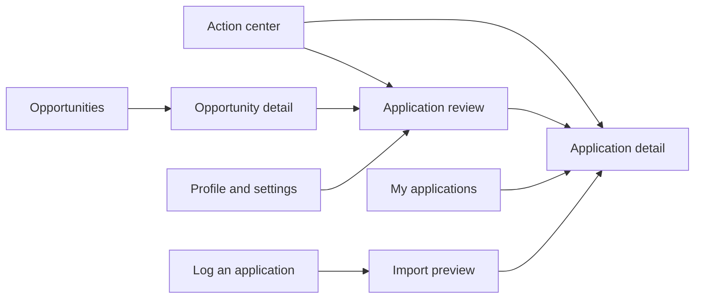

# Lelouvre: screen specification

Design revision 1, October 19, 2026. Wireframes describe proposed behavior and contain illustrative placeholders, not live opportunities. Companion to ARCHITECTURE.md and SYSTEM_DESIGN.md.

Product name: Lelouvre. The current alternative prototype explores horizontal navigation with a split home screen: decisions on the left, application follow-up and agent status on the right. The sidebar wireframes below remain workflow references while the visual layout is being evaluated.

Scholarships are a second opportunity track; see SCHOLARSHIPS.md. The combined prototype demonstrates an All / Internships / Scholarships scope selector, scholarship-specific opportunity and application fields, cycle-aware scholarship manual imports, and recommendation/renewal tasks in the shared Action center. It uses fictional data and has no live integrations.

## Navigation and shared behavior



Primary navigation: Action center, Opportunities, My applications. Application review opens from tasks or opportunities. Log an application is available globally. Profile/settings and system health are secondary destinations. Each detail view has a stable URL, back navigation, and preserved filters.

Every screen shows a global submission state: paused, enabled within approved rules, or not configured. A persistent Pause submissions action does not stop discovery. Resume submissions revalidates queued work; it does not replay uncertain attempts. Show actual notification and source connection health, never a generic running indicator when disconnected.

Status updates must distinguish saved locally, queued, running, confirmed, and uncertain. Disable repeated destructive/side-effect actions during a pending request; the server must also enforce deduplication. Preserve form drafts through recoverable failures. Use plain labels and evidence links, with keyboard navigation, accessible field labels, non-color status indicators, and responsive layouts. Display times in the candidate timezone; show explicit dates rather than relative times alone for deadlines. Unknown deadlines and unknown timezones remain visible.

## 1. Action center: home

### Urgency and scanning

Use color with explicit labels and icons, never color alone. Red: urgent/overdue action with a verified deadline or time-sensitive consequence. Amber: review needed, approaching deadline, or an uncertain submission. Blue: informational activity or ongoing processing. Green: confirmed completion, such as a verified submission; it does not imply hiring eligibility. Neutral: saved, paused, or no action required. Application stage and urgency remain separate. Thresholds are configurable; unknown deadlines never receive fabricated urgency. Use restrained tinted labels rather than coloring entire screens.

Easy to scan means consistent alignment of company, role, location, application stage, applied date, evidence, next action, and urgency. My applications defaults to a compact searchable table on desktop and labeled stacked rows on mobile. Users can identify urgent items without opening every record. Counts distinguish confirmed submissions, user-reported submissions, and uncertain attempts.

Broad source coverage should be inspectable: enabled, access needed, unsupported, stale, or healthy for each source. Display last successful checks and original discovery channels. Social leads remain visibly unverified until employer/application destination checks succeed.

Purpose: answer what needs attention today. Order by overdue/time-sensitive tasks, blocking decisions, uncertain outcomes, then optional preparation. Show the reason for priority; do not invent a deadline to create urgency.

```text
+----------------------------------------------------------+
| Action center     [Pause submissions] [+ Log application] |
| Submissions: not configured | Email: not connected        |
+----------------------------------------------------------+
| URGENT                                                   |
| Company / Role | Assessment due DATE | [View task]        |
+----------------------------------------------------------+
| NEEDS YOUR DECISION                                      |
| Company / Role | Research statement | [Review]            |
| Profile        | Work authorization unconfirmed | [Open] |
+----------------------------------------------------------+
| NEEDS CHECKING                                           |
| Company / Role | Submission outcome uncertain | [Check]   |
+----------------------------------------------------------+
| RECENT ACTIVITY                                          |
| Confirmed submission / status update / new matches        |
+----------------------------------------------------------+
```

Task cards: company/role, task type, due date if known, why it needs the user, current application stage, and one primary action. Open task reveals evidence and available resolutions. Snooze requires a selected reminder date and does not hide an overdue deadline. Dismiss requires a reason for blocking tasks and does not make an unresolved submission eligible to retry.

Empty: 'Nothing needs your attention.' Link to opportunities. First use: show profile setup, add prior applications, choose sources, and configure alerts. Source or delivery outages appear as a separate service-health issue, not an applicant deadline. Loading or failed retrieval must not display a misleading zero task count.

## 2. Opportunities: discover and compare

```text
+----------------------------------------------------------+
| Opportunities                   [Search] [Filters]       |
| Summer 2027 | SWE / Security / Research | Outside SC      |
+----------------------------------------------------------+
| Company / Role        Eligibility     Fit      Deadline  |
| Example role          Needs review    Strong   Unknown   |
| Evidence summary: Python and REST APIs match             |
| Last verified: DATE             [View] [Save] [Dismiss]   |
+----------------------------------------------------------+
```

Filters: track, location, remote mode, employer, eligibility, availability, saved/dismissed, deadline, first seen, and already applied. Unknown location/season/eligibility can be inspected separately; never silently treated as matching. Default search uses Summer 2027 and outside South Carolina, with East/West Coast priority. Remote preference remains unconfirmed.

Cards show official source, verification date, eligibility separately from fit, main evidence, gaps, and existing application if any. Sort choices include priority, newest first seen, and known deadline. Unknown deadlines sort separately and are labeled. Do not describe first seen as date published.

Opportunity detail includes source snapshot, required/preferred skills, candidate evidence, unknowns, compensation/housing if stated, dates, and match explanation. Actions: Open official listing, Save, Dismiss, Prepare application, Already applied, and Report incorrect information. Already applied opens a prefilled manual import. Preparing a duplicate opens the existing application instead.

Empty: explain active filters and offer Clear filters. Missing verification: allow saving, show the source issue, and block submission until verified. Closed role: retain history, label closed, disable preparation for submission. A ranking failure leaves the listing inspectable with 'Match unavailable' rather than assigning a weak score.

## 3. Application review: exact packet and decisions

```text
+----------------------------------------------------------+
| Company / Role                  Packet revision N        |
| Eligibility: needs review | Submission: blocked           |
+----------------------------+-----------------------------+
| QUESTIONS & ANSWERS        | DOCUMENTS & EVIDENCE        |
| Contact facts: approved    | Resume version + preview    |
| Work authorization: unset | Exact file to be uploaded   |
| Statement: needs approval | Supporting profile facts    |
+----------------------------+-----------------------------+
| Blockers and changed fields                              |
| [Save draft] [Return to task] [Approve packet]            |
+----------------------------------------------------------+
```

Inspect exact questions, answers, required/optional fields, destination domain, selected document versions, and differences from the previous packet. Each generated substantive answer links to supporting candidate evidence. Clearly label unknown, draft, and approved content. Optional fields can remain blank where permitted; never silently pick consent or demographic choices.

Save draft never submits. Approve packet is disabled until required facts and eligibility blockers are resolved; the page explains each blocker. Approval stores authorization for this immutable packet only. Once approved, a separate 'Queue submission' action is available if the adapter is supported and submission is enabled. Routine packets may be authorized and queued by existing approved policy without visiting this screen; their records remain inspectable.

For user-reviewed packets, approval and queuing are separate actions. Exact copy: 'Approve packet' and 'Queue submission'. Show the resulting state and offer Cancel queued submission while it has not started. New question wording, document edits, or material listing changes create a new packet and invalidate the previous authorization. A stale browser tab receives a conflict notice and current revision; it cannot approve overwritten content.

No supported adapter: offer 'Open official application' and 'Log my submission'; do not promise automated execution. Login/CAPTCHA/MFA: show a user-action task. Failed submission remains a failed attempt; uncertain submission opens reconciliation and disables resubmit.

## 4. My applications: shared history

```text
+----------------------------------------------------------+
| My applications               [Export] [+ Log application]|
| [Search] [Stage] [Track] [Origin] [Needs attention]        |
+----------------------------------------------------------+
| Company / Role | Stage | Applied date | Next task         |
| Example        | Interview | DATE    | Prepare interview |
| Origin: manual | Evidence: user reported                 |
+----------------------------------------------------------+
```

Default to a searchable table, with an optional stage board. Keep origin (manual/agent), evidence level, posting availability, and execution status distinct. Counts exclude drafts and uncertain attempts from confirmed-submission totals. Report user-reported applications separately from receipt-confirmed applications while allowing a combined tracked-applications count.

Application detail: current stage; next action; official role link; saved posting; submitted or reported resume; exact packet where available; timeline; receipts; messages; notes; and tasks. Manual records may have missing packet/resume data, labeled 'Not recorded'.

Actions: Update status, Add response, Add note, Add task, Attach confirmation, Open posting, and Correct details. Status changes record occurrence date and evidence; import date is stored separately. Rejection/withdrawal removes inappropriate active tasks with a history entry. Offer tracking does not accept an offer. Withdrawal recorded here does not contact the employer; label the action 'Mark withdrawn'.

Uncertain outcome panel: inspect attempt evidence, add confirmation, mark verified not submitted with evidence, or keep unresolved. Only verified-not-submitted reconciliation can enable a fresh attempt, subject to full policy checks. A user's report that they applied can resolve tracking as user-reported but must not fabricate an automated receipt.

Empty: 'No applications logged yet' with manual-entry action. Export failure preserves filters and offers retry. Mailbox disconnected: retain recorded history and label automatic response updates unavailable.

## 5. Log an application: manual entry and import

```text
+----------------------------------------------------------+
| Log an application                                       |
| [Enter details] [Paste link/text] [Upload confirmation]   |
+----------------------------------------------------------+
| Company*  [                    ]                         |
| Role*     [                    ]                         |
| Job URL   [                    ]                         |
| Applied date [Unknown / date] | Stage [Applied]           |
| Optional: location, resume, confirmation, notes           |
| [Save draft]                         [Review and save]   |
+----------------------------------------------------------+
```

Accept direct details, job links, pasted confirmation text, and supported image/PDF/email exports. Validate allowed file types and size before upload; actual limits will be set during implementation and displayed. Link access failure must not prevent manual entry. Users can omit sensitive content and attach evidence later.

Import preview separates extracted versus user-entered values, flags low confidence, shows date uncertainty, and lists possible duplicate records. Actions: Create new record, Link evidence to existing application, or Review possible merge. Never overwrite conflicting stage/date automatically. New submissions are blocked for unresolved candidate duplicates affecting the same opportunity.

Company and role are required; date defaults to unknown, stage to Applied for this workflow, and origin to manual. User can instead select another actual stage. Incomplete entries remain drafts and do not count as applied. Saving persists the application/event/evidence links transactionally and then offers View application, Add another, or Add next task.

Rejecting an extraction does not delete a previously valid application. Duplicate upload is detected by content hash and application identity. Import save retries return the same result using an idempotency key. Failed upload preserves entered details; failed extraction permits manual completion. Corrections and merge reversal are accessible from application history.

## Secondary screens required for operation

Profile/settings: verified facts, resume versions, approved answers, target rules, always-review companies, submission pause controls, notification settings, connection management, export/deletion, and backup/restore. Work authorization displays unconfirmed until the user explicitly supplies approved answers.

System health: per-source last successful check, stale coverage, failed jobs, queue state, notification delivery outcomes, and storage/backup health when implemented. Technical details are expandable; user-facing guidance explains impact and recovery.

## Screen-level acceptance walkthroughs

| Walkthrough | Expected visible result |
|---|---|
| First visit with no data | Setup actions and accurate not-configured labels; no invented opportunities |
| Discover a strong role with unknown sponsorship answer | Evidence-backed fit plus separate eligibility blocker; no submission |
| Import an application already in the database | Existing record offered; no duplicate created |
| Upload an unreadable screenshot | Manual entry remains available and entered details are retained |
| Change a question after packet approval | Old approval invalidated; review identifies the changed field |
| Browser crashes after submit | Uncertain label and reconciliation task; resubmit unavailable |
| Receive an ambiguous interview message | Review task with message evidence; no unrelated status update |
| Posting closes while interviewing | Closed posting label alongside unchanged interview stage |
| Pause with jobs queued | Submission jobs stop before submit boundary; dashboard confirms pause |
| Update from a stale tab | Conflict shown with latest revision; no silent overwrite |

## Scope boundary

This specification defines screens and behavior, not a running dashboard or connected mailbox. A visual prototype may use clearly labeled sample data. Live monitoring, alert delivery, and submissions require separately implemented and verified integrations.
